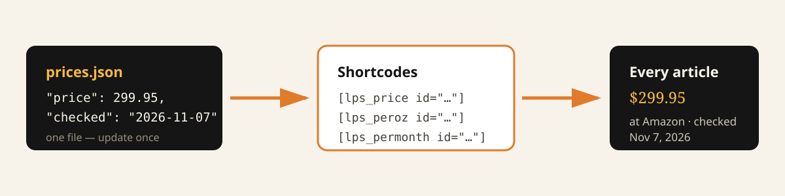

<h1 align="center">
  
</h1>

<p align="center">
  <a href="https://github.com/iSahinul/PriceOnce/releases"></a>
  <a href="https://github.com/iSahinul/PriceOnce/stargazers"></a>
  <a href="LICENSE"></a>
  <a href="#the-store-format"></a>
  <a href="#quick-start"></a>
</p>

<h3 align="center">
  <a href="#quick-start">Install</a> &nbsp;·&nbsp;
  <a href="#what-it-does">See how it works</a> &nbsp;·&nbsp;
  <a href="#the-shortcodes">Shortcodes</a> &nbsp;·&nbsp;
  <a href="#the-store-format">Store format</a> &nbsp;·&nbsp;
  <a href="#common-questions">Questions</a>
</h3>

**PriceOnce is a free, open-source WordPress plugin for affiliate and content sites.** Keep every product price in one JSON file. Your articles carry shortcodes, never typed numbers — so when a price changes, you update the file once and every post, page and guide is current on the next load, each price carrying the date you last checked it.

## What it does



*One store, shortcodes in your articles, fresh numbers everywhere. Update the file — not fifty posts.*

Typed prices go stale. Product-box plugins fix that only inside one retailer's API, and none of them compute the figures readers actually compare. This plugin renders, from the same live price:

- the price itself, with its store and **checked date**;
- **per-ounce** cost (`price ÷ unit size`);
- **per-serving** cost (any gram amount at the product's unit size);
- **per-month** running cost of a daily habit.

An unknown id, a missing price, or a missing unit size renders an **empty string** — never a stale number, never an error on the page.

## Quick start

1. Copy this folder into `wp-content/plugins/` — or drop the single PHP file into `wp-content/mu-plugins/`.
2. Copy `prices.example.json` to `prices.json` in the same folder, and put your products in it.
3. Write shortcodes in any post or page. Done — there is no settings screen and nothing else to configure.

To keep the store somewhere else, define `PO_STORE_PATH` in `wp-config.php`, or use the `po_store_path` filter.

## The shortcodes

| Shortcode | Renders |
|---|---|
| `[po_price id="example-espresso-machine"]` | $299.95 at Example Store · checked Nov 7, 2026 |
| `[po_peroz id="example-coffee-beans"]` | $1.58 — the price ÷ unit size in ounces |
| `[po_perunit id="example-coffee-beans" amount="18"]` | the cost of 18 g at the product's unit size |
| `[po_permonth id="example-coffee-beans" dose="18" perday="2" days="30"]` | the monthly running cost of the habit |

## The store format

```json
{
  "products": {
    "my-product": {
      "name": "My Product",
      "price": 299.95,
      "currency": "USD",
      "store": "Amazon",
      "url": "https://example.com/product",
      "checked_date": "2026-11-07",
      "unit_oz": 12,
      "unit_grams": 340
    }
  }
}
```

`price` is the only field every product needs. The per-unit shortcodes also need one of `unit_oz` / `unit_grams`. `checked_date` is the day you last verified the price — the stamp beside the price is what keeps the claim honest.

**Why a file, not the database?** So the store can be version-controlled, generated by a script (a price tracker, a spreadsheet export) and diffed like code. This plugin is the rendering half; pair it with any checker you like.

## Common questions

<details>
<summary><strong>Does it fetch prices automatically?</strong></summary>

No — on purpose. Fetching is a separate job (a tracker, a script, or you, once a week). This plugin guarantees the other half: whatever is in the store is what every page shows, with the date it was checked. A rendered price can never silently drift from the store.

</details>

<details>
<summary><strong>What happens if a product is missing from the store?</strong></summary>

The shortcode renders nothing. No placeholder, no wrong number, no PHP error. On a live site, an absent price is honest; a stale one is not.

</details>

<details>
<summary><strong>Which currencies are supported?</strong></summary>

USD, INR, EUR, GBP, AUD, CAD and JPY get their symbols automatically; any other currency code prints before the amount.

</details>

<details>
<summary><strong>Can I use it outside coffee products?</strong></summary>

Yes. The per-unit maths is generic: per-ounce suits any packaged good, per-serving suits anything sold by weight, and per-month suits any daily-use product. Coffee is simply where it was born — on a site where typed per-shot costs kept going stale.

</details>

## About the creator

**Built by Sahinul Islam Laskar** — I run content sites and the automation behind them: SEO measurement, price tracking and deal monitoring. This plugin is the rendering engine from a live affiliate site, extracted and open-sourced because the problem it solves — typed prices going stale across dozens of articles — belongs to every content site owner.

[GitHub](https://github.com/iSahinul)

---

Copyright © 2026 Sahinul Islam Laskar. [GPL-2.0 license](LICENSE).
